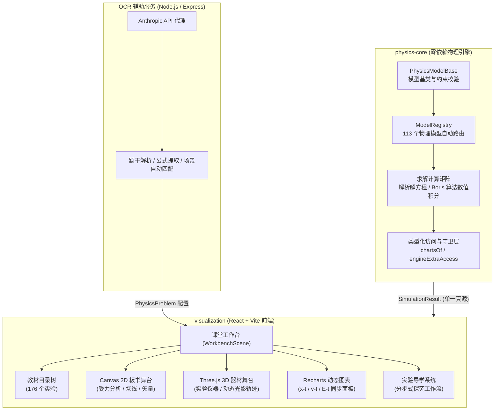
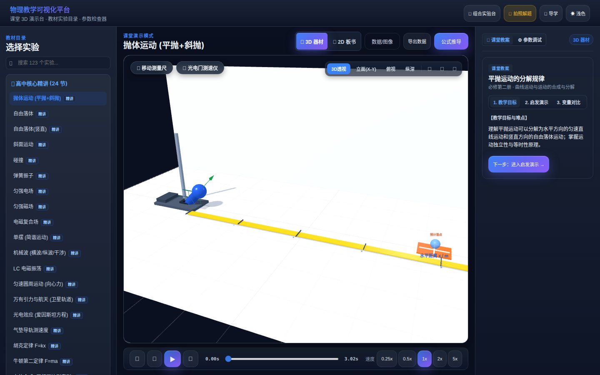
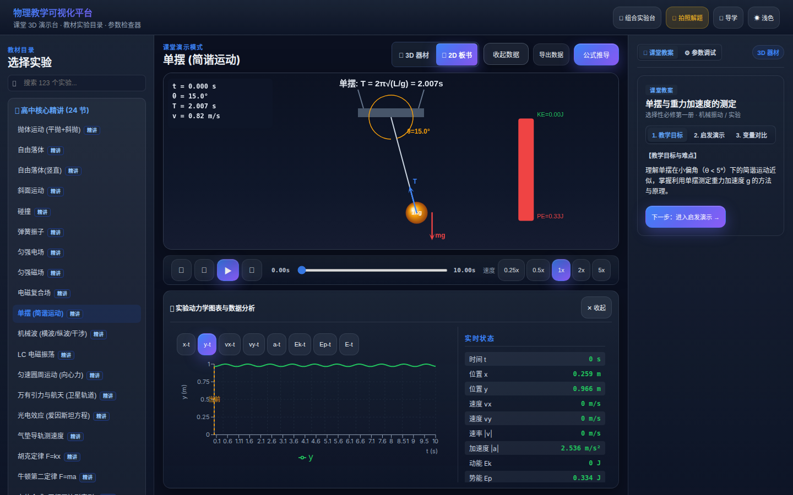
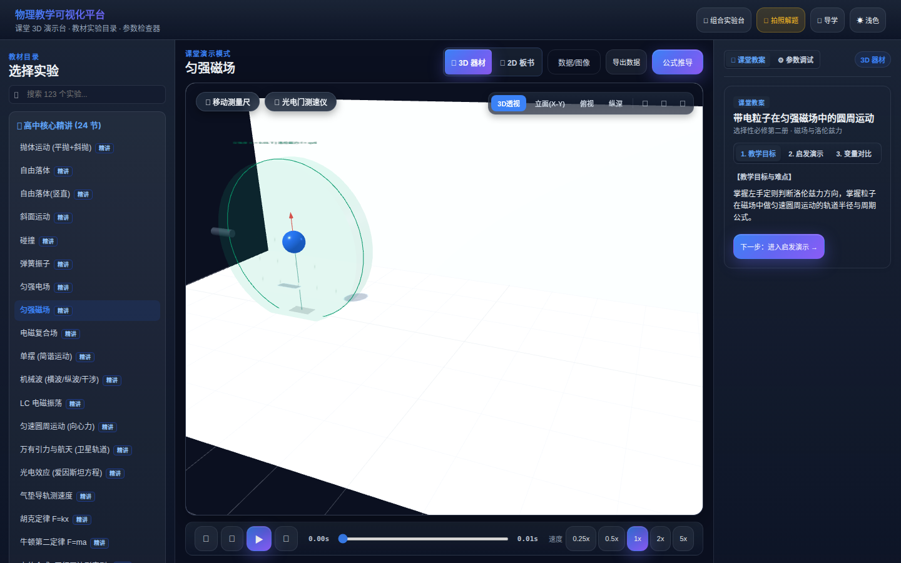
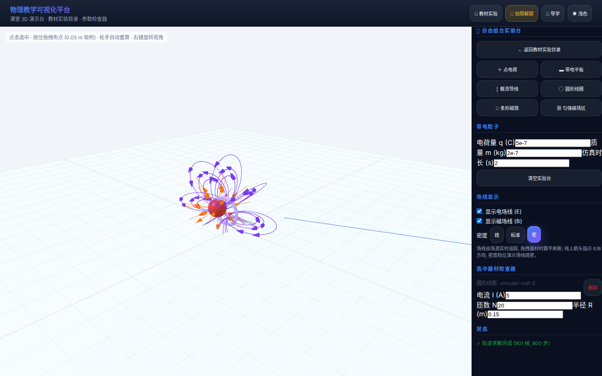
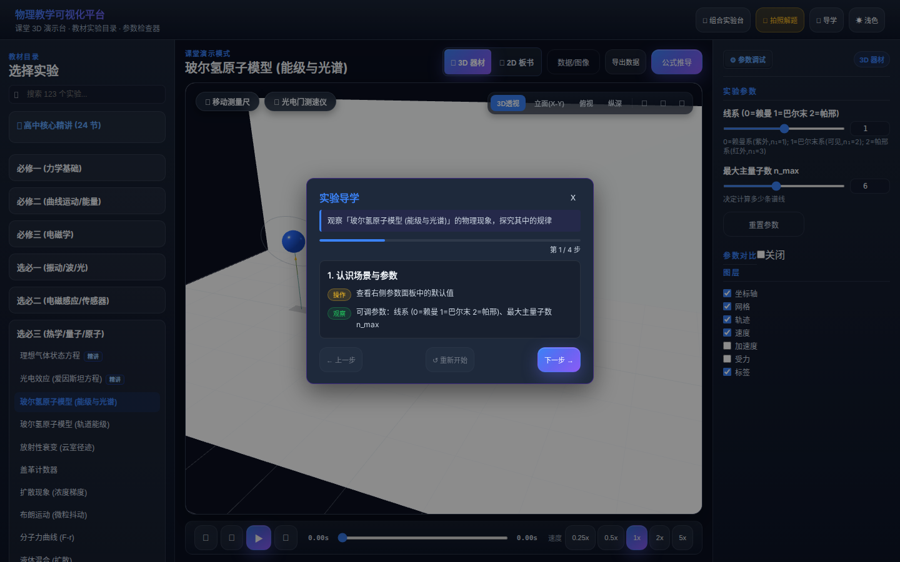
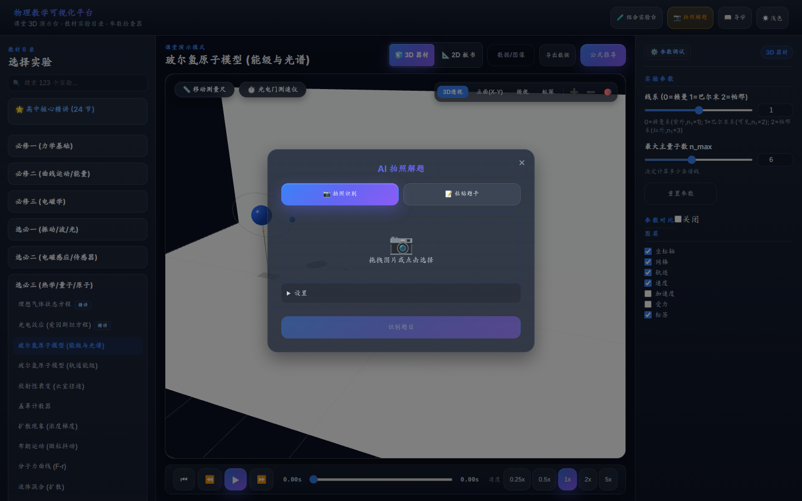

# PhysVis

> 面向高中物理教学的交互式可视化仿真平台。采用双层解耦架构：零依赖 TypeScript 物理引擎（`physics-core`）+ React 18 / Three.js 3D / Canvas 2D 互动课堂工作台（`visualization`）。

[](https://github.com/zhangjszs/physical-modelvis/actions/workflows/ci.yml)
[](https://zhangjszs.github.io/physical-modelvis/)
[](LICENSE)
[](https://zhangjszs.github.io/physical-modelvis/)
[](package.json)

---

## 核心指标

| 维度 | 指标与规模 | 说明 |
| :--- | :--- | :--- |
| **教材实验覆盖** | **176 个实验** | 覆盖人教版高中物理全套 6 册教材 / 27 章教学体系 |
| **可视化场景** | **123 个场景** | 覆盖力学、电磁学、热学、光学、近代物理五大板块 |
| **物理仿真模型** | **113 个模型** | 自研核心库，解析解为主，电磁复合场采用 Boris 数值积分 |
| **自动化测试** | **全量通过** | core 1181 / viz 1964 / 总计 3145 <!-- test-count --> |
| **首屏加载体积** | **≤ 70 kB gzip** | 生产入口 chunks 深度精简，路由与 3D 实验器材按需懒加载 |

---

## 系统架构

PhysVis 采用计算与渲染完全解耦的双层体系。前端渲染层严格遵循**单一真源契约（Single-Source-of-Truth）**：视图仅消费物理引擎产出的 `SimulationResult`，杜绝渲染层自行使用公式二次计算带来的数值漂移。



---

## 核心特性

- **双视口教学协同舞台**：支持「2D 规范板书」与「3D 真实实验器材」同屏联动。2D 画布聚焦物理受力示意、电磁场线与速度矢量分解；3D 舞台真实复刻实验台仪器与空间运动轨迹。
- **高保真双求解引擎**：
  - **解析解系统**：覆盖平抛/斜抛、简谐振子、一维碰撞、LC 振荡、衰变跃迁等经典物理过程，保证代数极值点与物理规律无累积误差。
  - **Boris 数值积分**：专门用于带电粒子在非平行电磁复合场中的运动模拟，严格保持相空间体积与长期能量守恒。
- **数据图表与物理守恒诊断**：内置 8 类物理曲线图（$x\text{-}t$、$v\text{-}t$、$a\text{-}t$、$E_k\text{-}t$、$E_p\text{-}t$ 等），支持 0.25x–5x 变速播放与单步调试，实时输出机械能/动量守恒误差分析。
- **分步式实验导学工作流**：将每个教材实验拆解为「现象观察 $\rightarrow$ 参数调节 $\rightarrow$ 规律验证」三步导学流程，贴合一线物理课堂教学需求。
- **自由组合电磁实验台**：内置速度选择器、质谱仪、平行板偏转、磁聚焦四大预设模板一键布置，支持六类器材自由拖拽与三维朝向编辑，动态计算双色叠加场线并配备轨迹变速回放控制。
- **AI 拍照解题与场景还原**：上传试卷习题图片或粘贴文字题干，智能识别题目类型与物理参量，自动装配并唤起对应的仿真场景。

---

## 界面演示

> 截图均从当前生产构建自动采集（1440×900）。详细视觉口径见 `scripts/capture-screenshots.mjs`。

| 课堂工作台总览 | 2D 板书与动态图表 |
| :---: | :---: |
| <br><sub>左侧人教版教材目录 · 中央 3D 演示舞台 · 右侧课堂教案面板</sub> | <br><sub>单摆规范受力分解板书 · 能量/位移-时间多曲线联动同步</sub> |

| 3D 空间实验器材 | 自由组合电磁实验台 |
| :---: | :---: |
| <br><sub>匀强磁场洛伦兹力回旋轨迹 · 真实比例仪器与空间场区</sub> | <br><sub>经典实验模板一键布置 · 双色叠加场线与轨迹回放控制</sub> |

| 实验分步导学流程 | AI 题目识别与仿真还原 |
| :---: | :---: |
| <br><sub>分步探究引导：观察物理现象 $\rightarrow$ 调参验证规律</sub> | <br><sub>习题图片 OCR · 物理参量结构化解析 · 一键载入仿真</sub> |

---

## 技术栈

| 分层 | 技术选型 | 作用与说明 |
| :--- | :--- | :--- |
| **物理计算引擎** | TypeScript（严格模式） | `physics-core` 纯净零外部依赖，输出解析解与 Boris 积分轨迹 |
| **前端框架** | React 18 + TypeScript | 模块化交互界面，Hooks 驱动物理求解与动画时钟生命周期 |
| **构建工具** | Vite 8 + ESBuild | 快速冷启动、模块热更新及生产环境 Rollup 分块优化 |
| **3D 渲染** | Three.js (v0.185+) | 空间实验器材网格组装、空间轨迹光影与场景 Rig 懒加载 |
| **2D 渲染** | HTML5 Canvas 2D API | 高帧率轨迹绘制、坐标轴网格、受力分析矢量箭头与场线渲染 |
| **图表组件** | Recharts (v2.15+) | 响应式多通道物理时间序列曲线，与动画帧严格插值同步 |
| **状态管理** | Zustand (v5.0+) | 极简轻量级全局状态管理，管理场景配置、播放时钟与参数变更 |
| **OCR 代理** | Express 5 + Anthropic API | 后端代理服务，解析试卷图片为结构化物理模型配置 |
| **测试框架** | Vitest 5 + Testing Library | 全量自动化测试、L1 差分精度测试与单一真源契约校验 |
| **代码质量** | ESLint 9 + Prettier + Husky | 本地 pre-push 质量门禁与 CI 全流程一致性保障 |

---

## 项目结构

```
physical_modelvis/
├── physics-core/              # TypeScript 物理模拟引擎（零依赖，113 个物理模型）
│   ├── src/
│   │   ├── models/            # 物理模型实现 (力学/电磁学/热学/光学/近代物理)
│   │   ├── math/              # 二维/三维向量运算与数值积分算法
│   │   ├── solver/            # 全局模型注册表与求解器路由分发
│   │   ├── types/             # PhysicsProblem 与 SimulationResult 核心契约
│   │   └── units/             # 国际单位制与物理常量定义
│   └── tests/                 # 单元测试与 L1 解析差分测试
│
├── visualization/             # 课堂可视化交互前端（123 个教学场景）
│   ├── src/
│   │   ├── components/        # UI 组件 (3D Stage, 导学面板, 图表, 拍照解题)
│   │   ├── scenes/            # 场景配置、参数定义与 buildProblem 映射
│   │   ├── rendering/         # Canvas 2D 领域渲染器与单一真源守卫层
│   │   ├── adapters/          # physics-core 与前端状态的适配桥梁
│   │   └── store/             # Zustand 全局教学与仿真状态
│   ├── server/                # OCR 后端代理 (Express + 题目结构化工具)
│   └── tests/                 # 渲染单元测试、单一真源契约测试与导学测试
│
├── experiments/               # 人教版高中物理 6 册教材 176 个实验目录与教学教案
├── docs/                      # 架构决策记录 (ADR)、渲染审计表与开发指南
│   ├── adr/                   # 架构决策文档 (ADR-001 ~ ADR-005)
│   ├── rendering-physics-audit.md # 123 个场景渲染源审计清单
│   └── DEVELOPMENT_GUIDE.md   # 完整开发者指南
└── scripts/                   # 11 层物理自检、包体积门禁与 Playwright 冒烟探针
```

---

## 快速开始

### 前置环境

- **Node.js**：`>= 20.0.0`（CI 环境基于 Node 24 验证）
- **包管理器**：`npm`（采用 npm workspaces 集中管理依赖）

### 安装与构建

```bash
# 1. 克隆代码仓库
git clone https://github.com/zhangjszs/physical-modelvis.git
cd physical-modelvis

# 2. 一键安装全项目依赖 (根目录 + physics-core + visualization)
npm install

# 3. 编译物理引擎产物 (前端通过 file:../physics-core 引用其 dist 产物)
npm run build:core
```

### 本地运行

启动可视化课堂工作台：

```bash
cd visualization
npm run dev
```

启动后在浏览器中打开：`http://localhost:5173`。

*(可选)* 启动 AI 拍照解题代理后端：

```bash
cd visualization
ANTHROPIC_BASE_URL="https://your-api-url" \
ANTHROPIC_AUTH_TOKEN="your-api-key" \
ANTHROPIC_MODEL="claude-3-5-sonnet-20241022" \
npm run server:dev
```

### 常用命令速查

| 操作 | 命令 | 说明 |
| :--- | :--- | :--- |
| **本地全量门禁** | `npm run precheck` | 运行构建 $\rightarrow$ 类型检查 $\rightarrow$ 代码规范 $\rightarrow$ 测试 $\rightarrow$ 体积检查 $\rightarrow$ 物理自检 |
| **运行所有测试** | `npm test` | 并行执行 `physics-core` 与 `visualization` 全量单元测试 |
| **TypeScript 检查** | `npm run typecheck` | 执行前后端及 OCR 代理的完整静态类型检查 |
| **11 层物理自检** | `npm run selfcheck` | 验证物理守恒律、数值无 NaN/Inf、模型参数范围与渲染源单一性 |
| **代码格式检查** | `npm run format:check` | 校验全库代码是否符合 Prettier 规范 |
| **生产全量构建** | `npm run build` | 依次生成物理引擎 dist 与前端生产部署静态资源 |

---

## 测试与工程化质量门禁

为确保教学仿真计算的物理严谨性与界面交互的长期稳定性，项目设立了多层次工程化防御网：

<!-- test-count -->

```
physics-core:   1181 tests passed (128 files)
visualization:  1964 tests passed (72 files)
Total:          3145 tests passed
```

### CI 流水线守卫矩阵（9 道防御环节）

每次 Push 或 Pull Request 均须在 GitHub Actions CI 流水线上依次通过以下自动化关卡：

1. **TypeScript 严格类型检查**：跨模块验证引擎与前端类型系统（含 OCR 服务），无类型隐式降级；
2. **ESLint 静态代码分析**：基于 `@typescript-eslint/recommended` 规范，杜绝冗余引用与逻辑隐患；
3. **Prettier 格式规范验证**：统一代码排版风格；
4. **测试断言空转扫描**：执行 `sweep-swallowed-assertions.mjs`，确保测试用例不存在吞没异常或伪绿灯现象；
5. **双引擎单元测试**：运行 2963 项单元测试与 L1 解析解差分测试；
6. **文档与测试数量单一真源校验**：自动核验 `README.md` 与 `docs/plan.md` 中的测试统计数值；
7. **11 层物理与契约自检（Self-Check）**：
   - **L0–L6**：模型基类规范、唯一性注册、参数与求解器映射；
   - **L8**：Boris 算法在多维电磁场中的积分收敛性与数值正确性；
   - **L9**：跨场景参数扰动与边界鲁棒性扫描（全量场景 `solveProblem` 零 `NaN` / 零 `Infinity`）；
   - **L10**：计算输出完整性检查；
   - **L11**：渲染层物理常量单一真源契约审计；
8. **首屏包体积门禁**：构建产物入口 chunks gzip 严格限制在 $\le 70\text{ kB}$，防范依赖膨胀；
9. **4 组 Playwright Headless 浏览器探针**：在生产构建 Preview 环境下执行首帧性能、双视口遮挡、Portal 主题继承与导学流程冒烟测试。

---

## 物理模型代表清单

`physics-core` 内置 113 个物理模型，自动向全局求解器注册。代表性模型分布如下：

| 领域 | 代表模型 | 求解方式 | 典型教学应用场景 |
| :--- | :--- | :--- | :--- |
| **运动学** | `uniform-linear` / `projectile` | 解析解 | 匀速/匀变速直线运动、平抛与斜抛运动分解 |
| **动力学** | `inclined-plane` / `circular-motion` | 解析解 | 斜面受力分解、滑动摩擦临界状态、圆周运动向心力 |
| **动量与能量** | `collision` / `spring-oscillator` | 解析解 | 一维完全弹性/非完全弹性碰撞、阻尼简谐振子机械能转化 |
| **经典电学** | `uniform-electric-field` / `circuit-dc` | 解析解 | 示波管电场偏转、带电粒子加速、闭合电路欧姆定律 |
| **经典磁学** | `uniform-magnetic-field` | 解析解 | 洛伦兹力偏转、回旋加速器粒子回旋半径与周期 |
| **电磁复合场** | `em-combined-field` | **Boris 算法** | 速度选择器、质谱仪、正交电磁场中的摆线运动轨迹 |
| **近代物理** | `bohr` / `alpha-scattering` | 解析解 | 卢瑟福 $\alpha$ 粒子散射、玻尔氢原子能级跃迁、光电效应方程 |
| **波动与热学** | `mechanical-wave` / `ideal-gas` | 解析解 | 简谐横波传播与干涉、理想气体状态方程（$p\text{-}V\text{-}T$ 过程） |

完整模型实现与参数定义请查阅 [physics-core/src/models/](physics-core/src/models/)。

---

## 文档中心与贡献指南

- 📖 **项目完整文档中心**：[docs/README.md](docs/README.md)
- 📋 **123 个场景渲染源审计表**：[docs/rendering-physics-audit.md](docs/rendering-physics-audit.md)
- 🛠 **物理仿真开发指南**：[docs/DEVELOPMENT_GUIDE.md](docs/DEVELOPMENT_GUIDE.md)
- 📌 **版本更新记录**：[CHANGELOG.md](CHANGELOG.md)

欢迎提交 Issue 与 Pull Request。提交 PR 前请在本地运行 `npm run precheck`，确保所有门禁全绿。

---

## 许可证

本项目基于 [MIT License](LICENSE) 开源发布。
